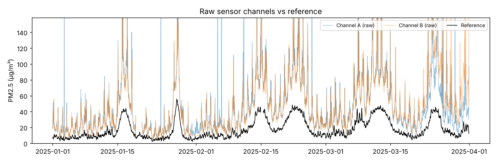
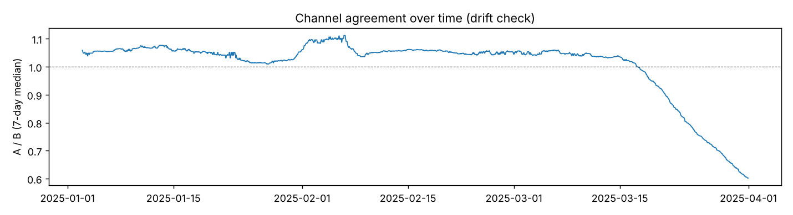
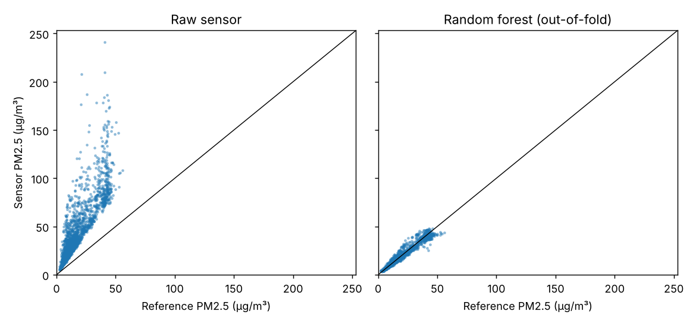
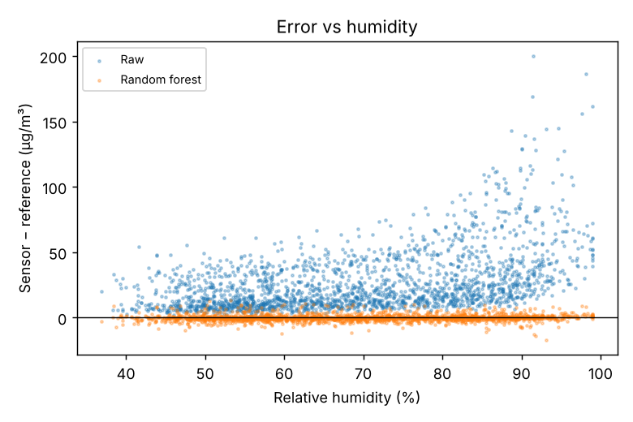

# Demo: PM2.5 sensor QA and calibration

> **Synthetic data.** This demo uses simulated data with known, injected faults (gaps, a stuck channel, spikes, drift). It shows the method, not a real site.

## Summary

- Co-located hours used for calibration: **2078**
- Raw sensor vs reference: R² 0.72, slope 2.27, RMSE 35.0 µg/m³
- Best model (**Random forest**, out-of-fold): R² 0.96, slope 0.95, RMSE 2.5 µg/m³
- Error reduced by **93 %** (RMSE)

## 1. Data quality checks

Each channel is checked for missing values, out-of-range values, stuck output
and spikes; hours where both channels survive but disagree are removed.

| Check | Hours flagged | Share |
|---|---|---|
| pm25_a_missing | 31 | 1.4 % |
| pm25_a_range | 0 | 0.0 % |
| pm25_a_stuck | 0 | 0.0 % |
| pm25_a_spike | 54 | 2.5 % |
| pm25_b_missing | 31 | 1.4 % |
| pm25_b_range | 0 | 0.0 % |
| pm25_b_stuck | 49 | 2.3 % |
| pm25_b_spike | 44 | 2.0 % |
| channel_disagreement | 4 | 0.2 % |
| high_rh | 86 | 4.0 % |
| usable_sensor_hours | 2091 | 96.8 % |

A ratio that moves away from 1 over time means one channel is drifting and
needs attention before its data are trusted.

## 2. Calibration models (time-blocked cross-validation)

Folds are whole weeks, so every score is measured on weeks the model never saw.
Targets (✅/❌) are the US EPA (2021) PM2.5 sensor targets: R² ≥ 0.7,
slope 0.65–1.35, intercept -5.0 to
+5.0 µg/m³, RMSE ≤ 7.0 µg/m³ or NRMSE ≤ 30.0 %.

| Model | n | r2 | slope | intercept | rmse | nrmse_pct | mae | mean_bias | r2_ok | slope_ok | intercept_ok | error_ok |
|---|---|---|---|---|---|---|---|---|---|---|---|---|
| Raw sensor | 2078 | 0.72 | 2.27 | 4.66 | 35.04 | 201.56 | 26.69 | 26.69 | ✅ | ❌ | ✅ | ❌ |
| Linear | 2078 | 0.70 | 0.70 | 5.13 | 6.59 | 37.91 | 4.44 | -0.01 | ✅ | ✅ | ❌ | ✅ |
| Linear + RH | 2078 | 0.82 | 0.82 | 3.09 | 5.17 | 29.75 | 3.61 | -0.03 | ✅ | ✅ | ✅ | ✅ |
| Linear + RH + T | 2078 | 0.81 | 0.82 | 3.16 | 5.18 | 29.80 | 3.59 | 0.01 | ✅ | ✅ | ✅ | ✅ |
| Hygroscopic growth model | 2078 | 0.88 | 0.89 | 1.91 | 4.09 | 23.52 | 2.76 | -0.01 | ✅ | ✅ | ✅ | ✅ |
| US EPA fixed correction | 2078 | 0.76 | 1.19 | 2.10 | 9.96 | 57.28 | 5.58 | 5.46 | ✅ | ✅ | ✅ | ❌ |
| Random forest | 2078 | 0.96 | 0.95 | 0.86 | 2.54 | 14.62 | 1.63 | -0.04 | ✅ | ✅ | ✅ | ✅ |

## 3. Limitations

- A calibration is only valid for conditions seen during co-location
  (season, concentration range, humidity, aerosol type). Re-check periodically.
- The US EPA fixed correction was derived for PurpleAir sensors (cf_1 channel);
  it is shown as a benchmark, not a recommendation for other sensors.
- Meeting the EPA targets at one site does not make a sensor a regulatory
  (reference-equivalent) instrument.
